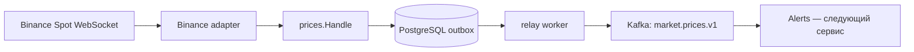

# Архитектура Market Data

## Поток

## Слои и зависимости

- `internal/prices`: проверка и нормализация сделки, порт `Outbox.Append`.
- `internal/binance`: исходящее WebSocket-соединение Gorilla WebSocket, подписка
  на пары из конфигурации, ping/pong, reconnect, передача сделки обработчику.
- `internal/postgres`: pgx, уникальная запись outbox, выборка и отметка доставки.
- `internal/relay`: сценарий доставки через порт Repository и Publisher.
- `internal/kafka`: Sarama, ключ пары, синхронное ожидание подтверждения Kafka.
- `internal/httpapi`: Gorilla Mux, только GET /healthz и GET /readyz.
- `internal/config`: чтение и проверка окружения.
- `cmd/market-data`: сборка зависимостей, миграции по отдельной команде, lifecycle.

HTTP-сервер не принимает биржевые сообщения: Market Data является клиентом Binance.
Бизнес-логика не зависит от mux, pgx, Sarama или WebSocket.

## Хранение и доставка

Outbox содержит sequence id, уникальный event_id, ключ инструмента, JSON payload,
created_at и published_at. INSERT ON CONFLICT(event_id) DO NOTHING позволяет
безопасно повторить сохранение. Отдельной таблицы рыночных сделок нет: здесь outbox
служит долговечной входной очередью, а не атомарной связкой двух разных записей.

Relay начинает транзакцию, получает глобальный advisory transaction lock,
читает ограниченный пакет неотправленных записей по id. Для каждой ждёт подтверждения
Kafka и отмечает published_at. Транзакция фиксируется после пакета; при сбое откатывается.
Lock не допускает параллельную публикацию пакетов разными экземплярами relay.
Транзакция держится во время сетевого вызова — осознанный компромисс простой версии.
Размер пакета и таймауты ограничены; горизонтальное масштабирование relay не реализовано.
Это порядок сохранённых записей, не гарантия хронологии Binance.

После Kafka ack, но до commit возможна повторная отправка всего пакета.
Гарантия — at-least-once для сохранённых событий при восстановлении зависимостей.
Ошибки/отмена не отмечают записи доставленными. Kafka topic создаётся отдельно;
автосоздание топиков клиентом не используется. Publisher не считается healthy только
потому, что конструктор отработал: соединение создаётся лениво и повторяется при ошибке.

Доставленные записи очищаются ограниченными пакетами по сроку хранения (24 часа
по умолчанию); недоставленные не удаляются. После очистки дубликат может снова попасть
в Kafka. Alerts должен иметь собственную защиту от повторных срабатываний.

## Сбои и ограничения

- Kafka недоступна: relay повторяет попытки с задержкой, приём продолжает писать в БД.
- БД недоступна: клиент повторяет сохранение текущей сделки без роста очереди в памяти.
  Пока чтение остановлено, соединение может оборваться; после сохранения клиент переподключится.
- Binance разорвал соединение: reconnect с ограниченной задержкой и повтор SUBSCRIBE.
- До commit outbox или во время разрыва WebSocket возможны потери сделок. Backfill
  пока отсутствует; нельзя обещать обнаружение каждого краткого пересечения порога.
- Неисправимый payload отклоняется и логируется без записи содержимого целиком.
- При накоплении pending outbox место на диске не ограничено программно. Нужны контроль
  размера, возраста очереди и измерение предела записи PostgreSQL до высоких нагрузок.
- Нет batching при приёме, TLS/SASL для Kafka в локальном MVP и публичного HTTP API.
  Локальные порты привязаны к loopback; не публиковать такое окружение в интернет.

## Жизненный цикл

Один процесс: HTTP server, Binance reader, relay loop. SIGINT/SIGTERM отменяет контексты,
закрывает WebSocket, прекращает циклы; HTTP получает ограниченное время Shutdown.
Sarama SyncProducer не поддерживает отмену уже начатого SendMessage: операции ограничены
сетевыми таймаутами. Отмена до отправки соблюдается; неизвестный результат не теряет outbox.
Readiness проверяет БД и актуальное состояние WebSocket; Kafka не блокирует готовность
принимать в outbox. HTTP liveness не зависит от внешних сервисов.

## Взаимодействие с будущими сервисами

Identity выдаёт токены, Alerts владеет правилами, Notifications доставляет срабатывания.
Их реализации сейчас нет. Пока инструменты заданы SYMBOLS. Динамические команды
от Alerts, их версии, snapshot и состояние активации требуют отдельной спецификации;
текущий сервис не имитирует этот ещё не существующий контракт.

## Выбор Kafka-клиента

Выбран github.com/IBM/sarama. На 2026-10-18 официальный репозиторий показывает около
12,5 тысяч звёзд, больше, чем рассмотренные kafka-go, confluent-kafka-go и franz-go.
Звёзды — ориентир популярности, не доказательство доли production-установок.
Источники: https://github.com/IBM/sarama и документация https://pkg.go.dev/github.com/IBM/sarama.
Конкретные версии зависимостей зафиксированы в go.mod/go.sum.
